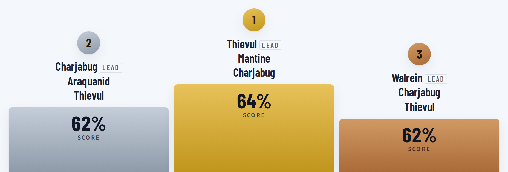
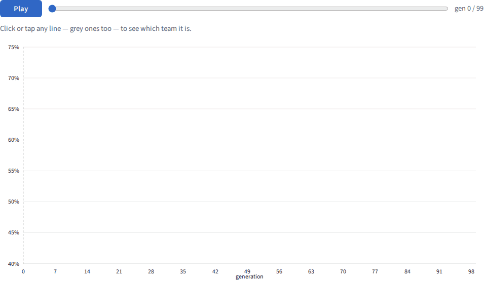

# Pokémon Go GBL Team Generator 🏆

<p align="center">
  <picture>
    <source media="(prefers-color-scheme: dark)" srcset="docs/podium-top3-dark.png">
    
  </picture>
</p>

Finds the strongest GO Battle League teams you can build from your own Pokemon collection. Teams are
ranked by simulating full 3v3 battles against the current meta with [pvpoke](https://pvpoke.com)'s
battle engine, and a genetic algorithm searches for the best ones.

Version [v1.0.0](CHANGELOG.md), with [release notes](https://github.com/Gidntsquia/pogo-gbl-team-generator/releases).

<p align="center">
  
</p>

The run above, which produced the podium at the top, covers 100 generations of evolutionary search
over my 107-mon collection, with 443,923 battles simulated. Each line is one team's win rate per
generation; the colored lines are the final top 10.

## Quickstart 🚀

Requires Node 18+.

1. Record your screen while swiping through all your Pokemon with the appraisal panel open.
2. Convert the video into a CSV with
   [Pokemon GO Video-to-CSV](https://github.com/Gidntsquia/pokemon-go-video-to-csv) (macOS only).
   A [Poke Genie](https://pokegenie.app) CSV export also works.
3. Run:

```
git clone https://github.com/Gidntsquia/pogo-gbl-team-generator
cd pogo-gbl-team-generator
npm run setup                                  # Downloads pvpoke's engine + data (needed after every fresh clone)
scripts/sim.sh --quick your-collection.csv     # 3-generation smoke run, prints the report path
scripts/sim.sh your-collection.csv --name mine --threads 4 --hours 1
```

The report is written to `out/evolve-mine/my-teams-evolve.md` and `.html`.
`fixtures/sample-pokegenie.csv` is a small collection for trying it out.
With an NVIDIA GPU and `uv`, `node scripts/evolve.mjs <csv> --gpu` runs battles on the GPU too (see RUNBOOK.md).

Other commands:
```
scripts/sim.sh your-collection.csv --name ultra --cp 2500   # Ultra League
scripts/sim.sh --meta --name meta-1                         # Meta vs meta, no collection needed
```

## MCP Server 🤖

`.mcp.json` registers the `pogo-sim` server for [Claude Code](https://claude.com/claude-code)
sessions in this folder. It can launch, watch, stop and resume runs, and a launched run keeps going
after the session closes. Ask "Report on sim status" and it returns the run's state, generation,
ETA and memory, plus tables of the top candidate teams, candidate mons, opponent teams and opponent
mons. The `pogo-sim-extra` server (reports, analysis, collection builders) is off by default; turn
it on with `/mcp`.

## Features 🔬

- Teams are ranked by simulated 3v3 battles with switching and shields across all 9 lead matchups.
- The candidate teams and the opponent pool evolve against each other. Interrupted runs resume from
  their checkpoints.
- Mons also compete as each evolution they can still become.
- Every ranked team has a build cost in Stardust, Candy and Candy XL, with shadow, purified and lucky
  modifiers.
- Meta-vs-meta mode runs without a collection; its results can seed the curated opponent teams.
- Great and Ultra League, pvpoke cups (`--cup willpower`) and species bans (`--ban`) work.
- The same seed gives identical results, serial or with `--threads N`.

## Documentation 📚

The [Runbook](RUNBOOK.md) has the standard recipe and every run command. More details in the
[wiki](https://github.com/Gidntsquia/pogo-gbl-team-generator/wiki):

- [Running the CLI](https://github.com/Gidntsquia/pogo-gbl-team-generator/wiki/Running-the-CLI) — sim.sh, flags, leagues, cups, threads
- [How Scoring Works](https://github.com/Gidntsquia/pogo-gbl-team-generator/wiki/How-Scoring-Works) — battles, sampling weights, role priors
- [Build Costs and Evolutions](https://github.com/Gidntsquia/pogo-gbl-team-generator/wiki/Build-Costs-and-Evolutions) — Stardust and Candy math
- [Evolutionary Team Search](https://github.com/Gidntsquia/pogo-gbl-team-generator/wiki/Evolutionary-Team-Search) — the genetic algorithm and checkpoints
- [Shared Collections](https://github.com/Gidntsquia/pogo-gbl-team-generator/wiki/Shared-Collections) — teams two players can both build
- [Development and Tests](https://github.com/Gidntsquia/pogo-gbl-team-generator/wiki/Development-and-Tests) — test tiers
- [MCP Server](https://github.com/Gidntsquia/pogo-gbl-team-generator/wiki/MCP-Server) — the pogo-sim tools
- [MCP Server Token Costs](https://github.com/Gidntsquia/pogo-gbl-team-generator/wiki/MCP-Server-Token-Costs) — what the MCP server saves over Bash
- [Research](https://github.com/Gidntsquia/pogo-gbl-team-generator/wiki/Research) — approaches tried and not adopted

## License 📄

[MIT](LICENSE). The vendored battle engine ([pvpoke](https://github.com/pvpoke/pvpoke)) is also
MIT-licensed and is downloaded at setup rather than distributed here.
