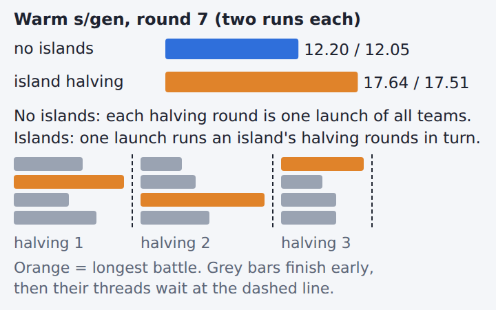
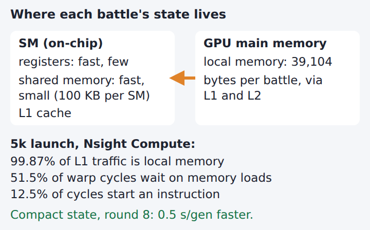
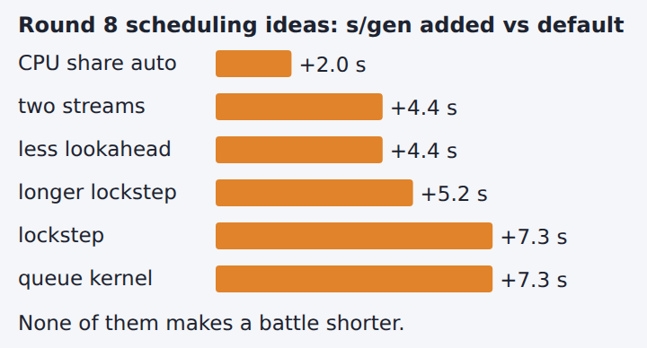
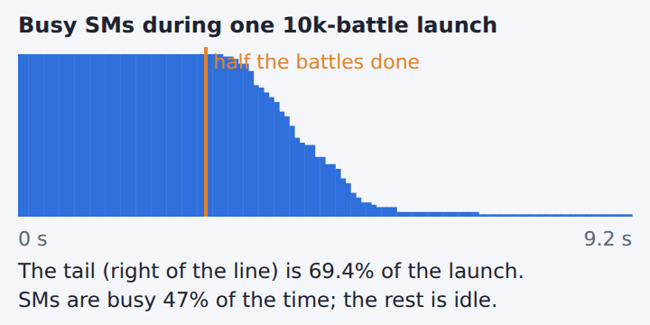
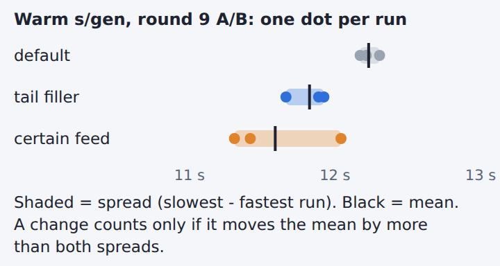

# GPU round 9, explained 🧭

Five ideas from GPU study rounds 7-9, one picture each. Sources: `out/gpu-study.html` and `out/gpu/study/` (branch `gpu`).

## Terms
- **Generation:** one step of the team search; its **halving rounds** each cut the bottom half. **Round 7-9:** study rounds.
- **SM:** one of the GPU's 68 cores. A **warp** is 32 threads it runs together.
- **Registers, shared memory:** small, fast storage on an SM. **L1, L2:** caches between the SMs and GPU main memory.
- **Launch:** one batch of battles sent to the GPU; it ends with its last battle. A **stream** is a queue of GPU work.
- **5k launch:** a recorded launch of 4,788 battles. A **replay** runs a recorded launch again with timers.
- **Lookahead:** a battle's search of next moves. **Nsight Compute:** NVIDIA's GPU profiler.
- **Tail filler, certain feed:** round 9 fills idle SMs with next-round battles, or battles of teams sure to pass.
- **Warm s/gen:** seconds per generation, early generations left out (see the last section).
- **A/B:** default and a change in turns. **Lockstep:** each launch moves every battle 32 or 128 steps.

## Island halving costs 5.4 s per generation

Island halving splits the teams into groups (islands) and runs each island's halving rounds in one launch.

Each round waits for its longest battle while the other threads sit idle.

## Battle state sits in slow memory

Each battle keeps 39,088 bytes of state in local memory: teams, HP, energy and its lookahead.

Local memory is GPU main memory, behind L1 and L2. Nsight Compute shows half of warp cycles wait on it.

Round 8's compact state packs fields into 8 and 16 bits. It saved 0.5 s per generation in an A/B of 3 runs each.

## Each scheduling idea added time

Two streams overlap CPU-side work with the GPU. CPU share auto moves some battles to the CPU.

Less lookahead memory re-runs battles that overflow it, one at a time.

The queue kernel hands threads whole battles from a list.

None makes a battle shorter, and a launch still waits for its longest one. I did not measure why each one added time.

## The tail, and why it is the target

The tail runs from when half a launch's battles are done to its end. SMs run out of work one by one.

Round 9's tail filler and certain feed run more battles there. SMs stayed busier; a launch still ends with its longest battle.

## Reading warm s/gen and its noise

Warm s/gen: mean seconds per generation once the share of battles answered from saved results has levelled off.

Repeated runs differ a little; the spread (slowest minus fastest) is that noise. A change counts only if it beats both spreads.
